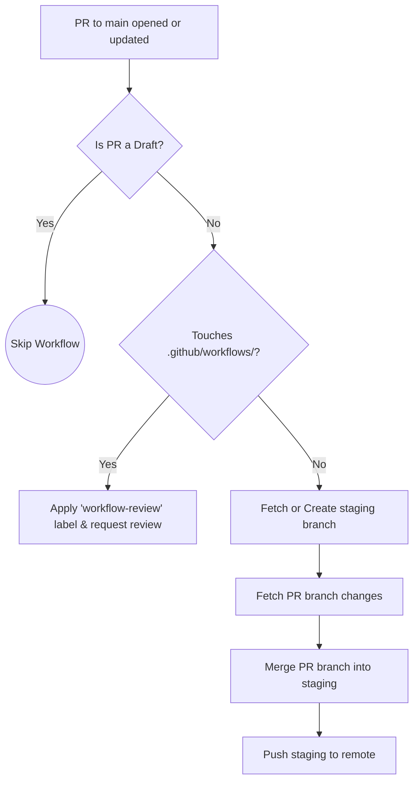
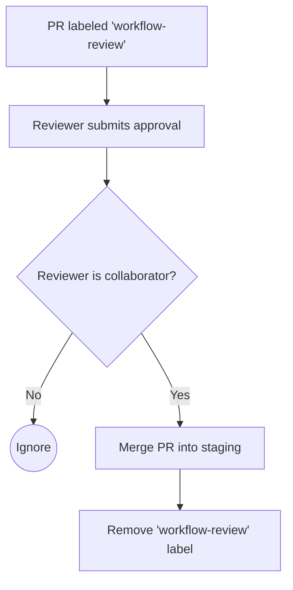
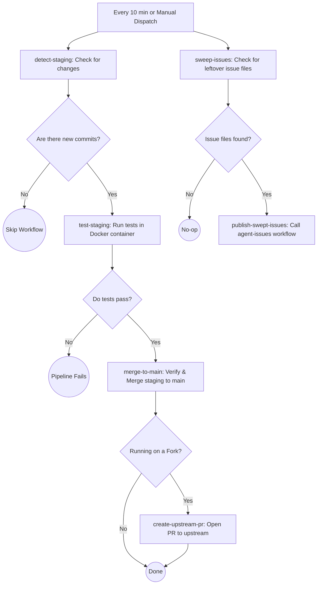
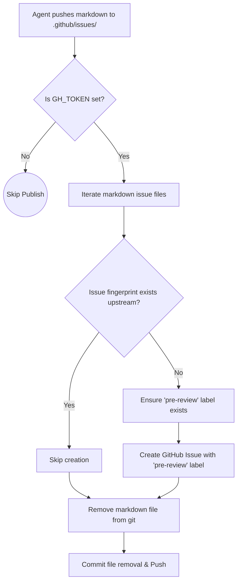
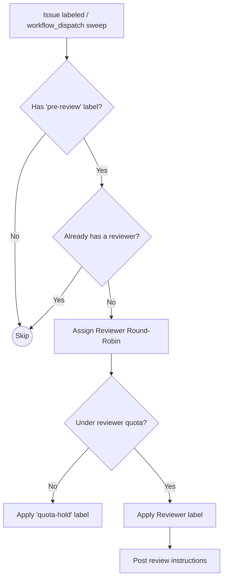
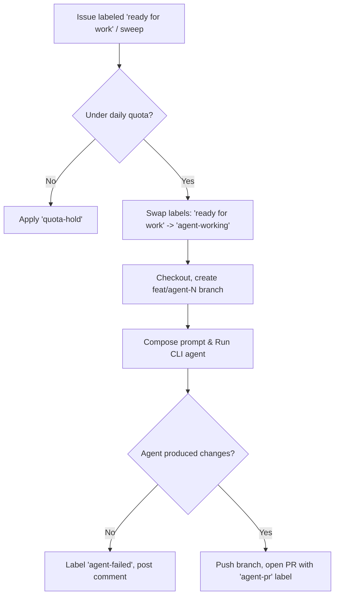
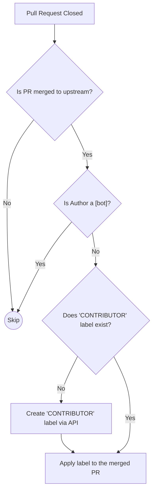
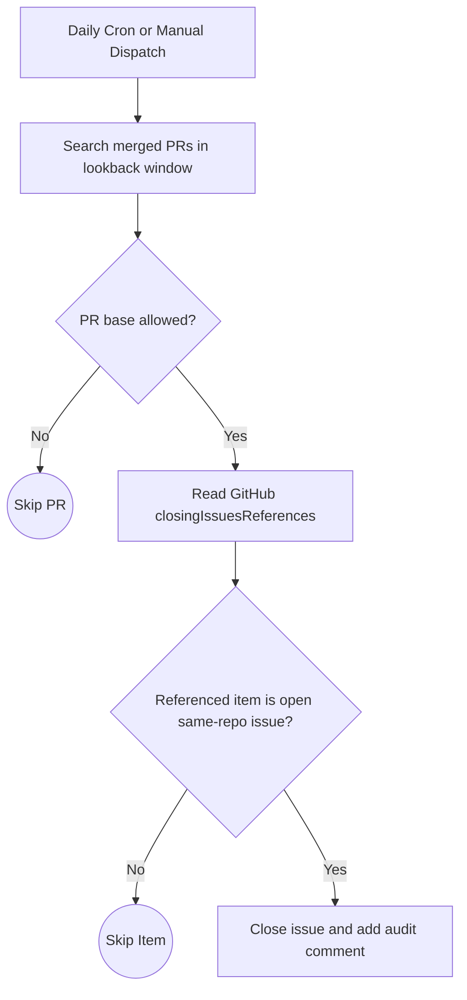
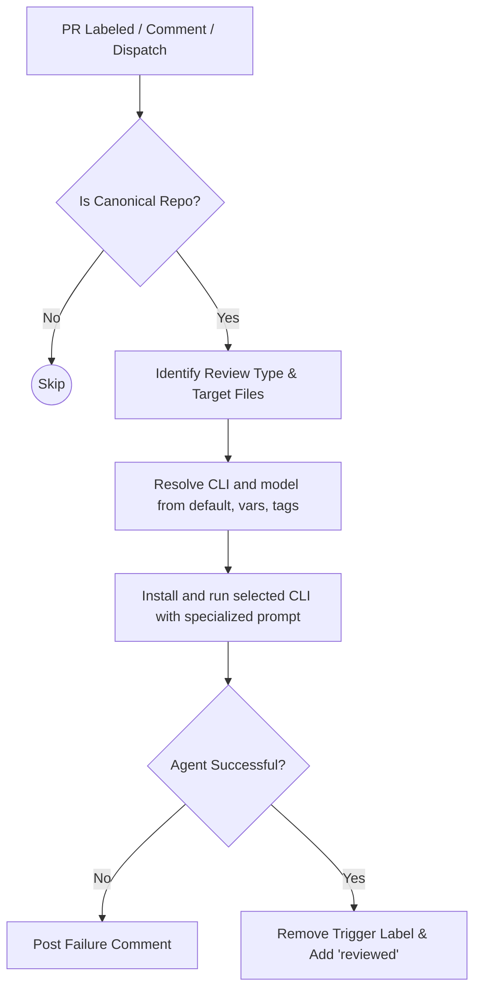
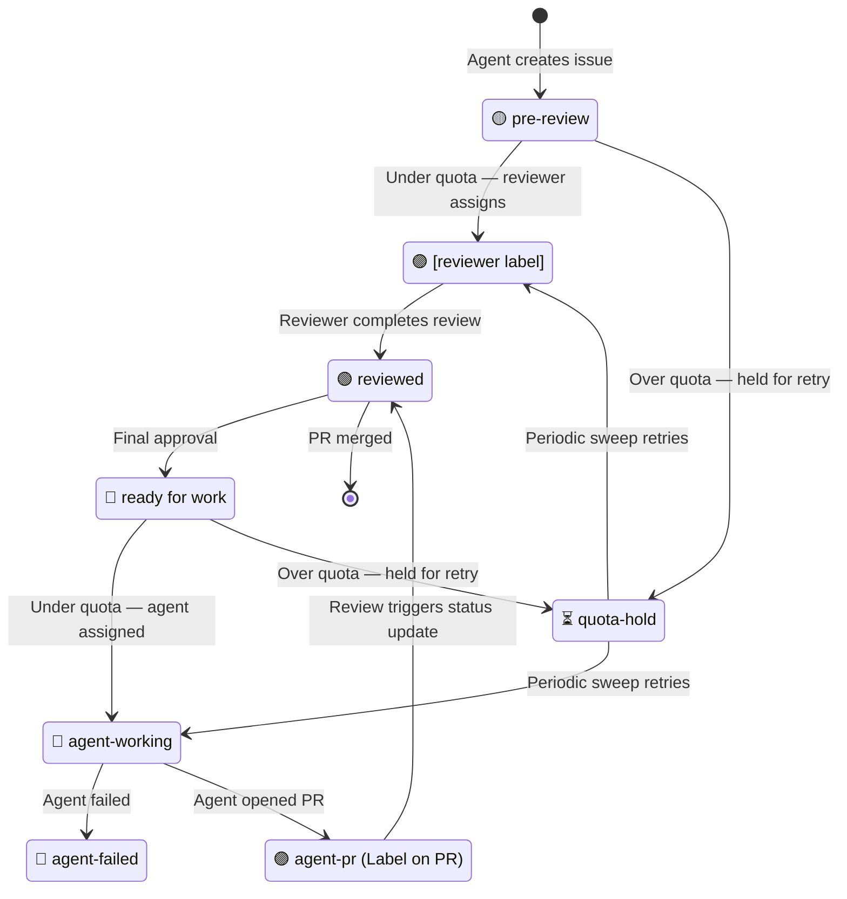

# Continuous Integration & Delivery (CI/CD)

This document outlines the automated pipelines that power the development lifecycle of this project. All automation is handled via GitHub Actions and can be found in the `[.github/workflows](../.github/workflows)` directory.

## Workflows Overview

### Swarm verification

On pushes outside `main`, `swarm-node.yml` starts an isolated loopback DHT and
checks that two real Hyperswarm nodes discover each other and exchange a message.
This verifies local coordination without depending on public bootstrap servers;
it does not check public DHT reachability. The scheduled seed job still uses
the configured swarm key and public network.

### 1. Auto-merge PR to Staging
**Trigger:** `pull_request_target` (opened, synchronize, reopened, ready_for_review) against `main`.
**File:** `auto-merge-staging.yml`

This workflow enforces an "open-by-default" staging environment. Whenever a non-draft Pull Request is opened against the `main` branch, it is automatically merged into the `staging` branch — **unless** the PR modifies files in `.github/workflows/`, in which case it is held for review (see *Workflow File Protection*).



### 1b. Workflow File Protection
**Trigger:** `pull_request_review` (submitted) on PRs labeled `workflow-review`.
**File:** `workflow-review.yml`

PRs that modify `.github/workflows/` files have supply-chain security implications (arbitrary code execution, secret access). These PRs are not auto-merged; instead they receive a `workflow-review` label and a comment tagging configured reviewers. When a repository collaborator approves the PR review, this workflow merges the PR into staging.



### 2. Periodic Merge to Main
**Trigger:** `schedule` (every 10 minutes) or `workflow_dispatch`.
**File:** `periodic-merge-main.yml`

This scheduled job acts as the gatekeeper to production (`main`). It periodically checks the `staging` branch, runs all automated tests, and if everything passes cleanly, promotes staging into `main`. It also sweeps for any leftover issue files on `main` and publishes them.

The test job builds a Python 3.12 / Node 22 dependency image from the staged dependency manifests, then runs lint and the complete pytest suite in a container with network access disabled. Missing test tools fail the job. `HOURLY_TEST_COMMAND` and `HOURLY_TEST_IMAGE` no longer override these required checks. Promotion checks that both main and staging still match their selected snapshots before a normal merge and push; concurrent updates cause a retry on the next cycle.



### 3. Publish Agent Issues
**Trigger:** `push` modifying `.github/issues/*.md`, `workflow_call`, or `workflow_dispatch`.
**File:** `agent-issues.yml`

This workflow handles automated issue generation by AI agents. When markdown files are pushed to `.github/issues/`, this action parses them, translates them into actual GitHub Issues on the upstream repository, and applies the `pre-review` label to signal that the issue needs triage.



### 4. Issue Reviewer
**Trigger:** `issues` (labeled) or `workflow_dispatch`.
**File:** `issue-reviewer.yml`

When an issue is labeled with `pre-review`, this workflow assigns it to a reviewer (AI agent or human) defined in `.github/reviewers.yml`. It uses a round-robin strategy based on the issue number and checks per-reviewer rolling 24h quotas (defined as repository variables). Over-quota issues receive a `quota-hold` label and are retried automatically.



### 5. CLI Agent Issue Solver
**Trigger:** `issues` (labeled `ready for work`), `workflow_dispatch`.
**File:** `agent-issue-solver.yml`

This workflow attempts solutions for issues marked as `ready for work`. It checks
`AGENT_DAILY_TASKS`, creates a fresh `feat/agent-N-RUN_ID` branch, and runs the
agent with a prompt stored outside the checkout. A successful invocation with
repository changes opens a PR for review. Failed invocations and empty results
mark the issue `agent-failed` and fail the Actions job; they cannot publish a
solution PR merely because the generated prompt changed.

The default OpenCode runner uses the repository **Actions secret**
`OPENROUTER_API_KEY`, falling back to `AGENT_API_KEY` for compatibility. A local
`.env` file is not uploaded to Actions. The default model is
`openrouter/nvidia/nemotron-3-ultra-550b-a55b:free`; `AGENT_MODEL` can override
it. Native providers require their matching key or the legacy `AGENT_API_KEY`;
an OpenRouter credential is never substituted for an Anthropic/OpenAI key.
Provider credentials are scoped to the execution step. Both issue workflows use
`scripts/run-issue-agent.py`, which invokes `opencode run --format json` with
stdin, verifies terminal assistant events, enforces a ten-minute timeout, and
isolates HOME/XDG/OpenCode state per invocation. It does not retry code-writing
model calls automatically because partial edits may already exist.

To retry a particular open issue after installing this workflow change:

```bash
gh workflow run agent-issue-solver.yml --ref main -f issue_number=97
```

Repeat for #98, #90 or #88 after reviewing their current scope. Explicit retries
still respect the daily quota and refuse issues already marked `agent-working`.
Old workflow reruns execute the old workflow revision; adding credentials alone
cannot repair its unsupported CLI flags. Use a new dispatch on the updated
branch. Successful publication clears the stale `agent-failed` issue label.

`agent-pr` records that automation created a PR; it does not certify a fix.
Existing PRs #92, #93, #99 and #100 contain only generated prompt changes and
must not be merged as issue solutions. New solver runs use fresh branches rather
than force-pushing over those PRs. Parallel workers retain their shared branch;
failed partial-progress PRs are drafts and do not claim to close the issue.



### 6. Label Contributors
**Trigger:** `pull_request` (closed).
**File:** `add-contributors.yml`

A community management workflow that ensures every contributor who successfully merges code gets recognized, human or otherwise. When a PR is merged, the author automatically receives the `CONTRIBUTOR` label. Currently, accounts ending in `[bot]` are skipped; this may be revisited as agent participation grows.



### 7. Daily Issue Close Sweep
**Trigger:** `schedule` (daily) or `workflow_dispatch`.
**File:** `daily-close-merged-issues.yml`

This workflow closes stale open issues that are already resolved by merged PRs when native GitHub auto-close did not fire. To prevent false positives, it only closes issues that appear in GitHub's own `closingIssuesReferences` for merged PRs, only for allowed base branches (`ISSUE_CLOSER_ALLOWED_BASE_REFS`, default: `main,staging`), only when the target is still an open issue in the same repository, and skips issues that were manually reopened after the PR merge.



### 8. Specialized AI PR Reviews (CLI)
**Trigger:** `issue_comment`, `pull_request_review_comment`, `pull_request` (labeled), `workflow_dispatch`.
**File:** `opencode.yml`

This workflow provides targeted AI analysis on Pull Requests using a pluggable CLI runner. It can be triggered manually via `/oc` commands or automatically by adding labels like `workflow-review`, `arch-review`, or `security-review`. The workflow identifies changed files relevant to the review type, posts a guiding comment, runs the selected CLI directly, and posts the CLI output back to the PR.

CLI selection precedence is:
1. Default (`opencode`)
2. Repository variable (`REVIEW_AGENT_CLI`, then fallback `AGENT_CLI`)
3. PR label tag (`review-cli:<cli>` or `review-agent:<cli>`)

Both review runners (`opencode.yml` and `workflow-review-dispatch.yml`) default to
`auto`. The shared [model picker](model-picker.md) queries the current OpenRouter
catalog, requires free text/tool models with at least 256,000 tokens of context,
and ranks by documented total parameters, catalog release date, then context.
Unknown parameter counts rank below disclosed sizes. This implements the
capacity-first criterion; it is not a benchmark of review quality.

Provider failures try the next candidate, with bounded attempts and time.
A substantive review FAIL does not trigger another model. Evidence and comments
record the model that actually completed the review. Model IDs passed to OpenCode
include its `openrouter/` provider prefix; the catalog uses raw OpenRouter IDs.
Before the picker reaches the trusted base branch, reviews use the prior free
Nemotron 3 Ultra bootstrap model and emit an explicit notice. PR code is never
loaded as the privileged picker implementation.

Model selection in `opencode.yml` follows
`auto -> REVIEW_AGENT_MODEL/AGENT_MODEL -> nonempty manual model input -> review-model:<model>`.
The manual input defaults to empty so it does not mask repository settings.
`workflow-review-dispatch.yml` uses `REVIEW_AGENT_MODEL`, then `AGENT_MODEL`,
then the same default; it also honors `REVIEW_AGENT_CLI` before `AGENT_CLI`.
Explicit overrides may select a paid model, so use a `:free` model ID when
zero-cost inference is required.

For custom tooling, install and argument behavior can be customized in
`opencode.yml` with repository variables such as `REVIEW_AGENT_INSTALL_CMD`,
`REVIEW_AGENT_CLI_FLAGS`, `REVIEW_AGENT_MODEL_FLAG`, `REVIEW_AGENT_PROMPT_FLAG`,
and `REVIEW_AGENT_PROMPT_MODE`.

Configure the repository secret `OPENROUTER_API_KEY` for the default model.
The dispatch runner prefers that key for `openrouter/` models, with
`AGENT_API_KEY` as a legacy fallback; other providers continue to use
`AGENT_API_KEY`. The router key is scoped to credential validation and agent
execution. OpenCode is invoked as `opencode run --model <model>` with the full
prompt and diff streamed through stdin, avoiding command-line argument limits.
When selecting another CLI, set a model override that the selected CLI supports.

Security hardening notes:
- `/oc` and `/opencode` comment-triggered reviews only run for trusted associations (`OWNER`, `MEMBER`, `COLLABORATOR`).
- Default CLI installs are version-pinned, with package override variables (`REVIEW_OPENCODE_NPM_PACKAGE`, `REVIEW_OPENCLAW_NPM_PACKAGE`, `REVIEW_CLAUDE_NPM_PACKAGE`).
- Only the provider-specific API key for the selected model is injected into the CLI environment.

Public repository policy (risk classification):
- This repository does not use confidential secrets in code, repository variables, or GitHub Actions secrets.
- Reviewers should classify generic token plumbing as **best-practice hygiene** by default.
- Escalate to **high severity / no-go** only when there is concrete evidence of real sensitive data exposure, privilege escalation, or malicious behavior.



### 9. Decision-Gated Staging Admission

The optional `decision-merge` label requests full review and PR validation, then
requires an explicit automatic-review PASS with zero blocking findings, then
a separate typed Decisions API assessment across five review areas. At least four
areas must reach 80% YES probability, including correctness and security; an
identified unresolved blocker vetoes admission. The local rule admits the exact
reviewed commit to staging. The legacy staging paths defer opted-in PRs to this
gate. Existing tested promotion to main remains unchanged. Manual runs default
to dry-run; automatic runs apply accepted decisions. See
[`decision-merge.md`](decision-merge.md) for configuration, provenance checks,
retry behavior, and bootstrap requirements.

---

## Issue Lifecycle

All agent-generated issues follow a label-driven state machine. Labels are created automatically by workflows if they do not already exist. Issue throughput is governed by repository variables (rolling 24h window), with variable names defined per-reviewer in `.github/reviewers.yml`, and the `AGENT_DAILY_TASKS` variable for implementing agents.


